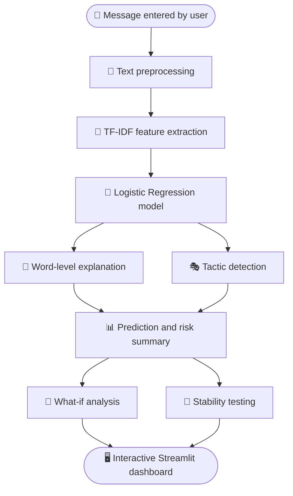

# 🔍 ScamLens

### *Explain the Scam, Not Just the Spam.*

An **Explainable AI (XAI)** system that shows people *why* a message looks suspicious, not just *whether* it does.

 

[Overview](#-overview) • [Features](#-key-features) • [Tech Stack](#-technology-stack) • [How It Works](#-methodology) • [Results](#-results) • [Setup](#-installation-and-usage) • [Limitations](#-limitations) • [Roadmap](#-future-scope)

---

## 📖 Overview

**ScamLens** analyzes SMS messages and email-style text, identifies suspicious language, explains common psychological manipulation tactics, and lets users explore how changes to a message affect the model's prediction.

Built by **Team VectorX** for **AI Innovation Hackathon 2026 — Challenge 05**.

> ⚠️ **Note:** ScamLens is an awareness and decision-support tool. Its output is **not** definitive proof that a message is fraudulent or safe.

## 👥 Team VectorX

| Name | Role |
|---|---|
| **M.A.N.P. Anawarathne** |  Team Leader |
| **H.M.H.N. Aberathna** | Team Member |
| **W.A.H. Sathsarani** | Team Member |

---

## 🎯 Problem Statement

People regularly receive suspicious messages that imitate trusted organizations, create urgency, threaten negative consequences, or promise rewards. A simple spam/scam label rarely explains what makes a message suspicious, leaving users without enough context to judge the risk or to recognize manipulation in future messages.

### The Transparency Gap

Many message classifiers give a prediction with no clear explanation. ScamLens closes this gap by combining text classification with interpretable word-level evidence and rule-based explanations of possible manipulation tactics. It also shows that predictions can change when wording is altered, helping users understand both the value and the limitations of AI-based detection.

## 💡 Proposed Solution

ScamLens combines a machine-learning classifier with explanation tools in one interactive dashboard. Alongside a scam-likelihood prediction, it:

- Highlights the most influential words
- Identifies possible manipulation tactics
- Provides safety guidance
- Lets users edit a message and test how robust the prediction is

---

## 🚀 Key Features

| | Feature | Description |
|:-:|---|---|
| 📨 | **Suspicious-message classification** | Predicts whether a message resembles a scam/spam message or a legitimate one. |
| 🔤 | **Word-level explainability** | Highlights the words that contribute to the model's prediction. |
| 🎭 | **Manipulation-tactic detection** | Flags patterns linked to *urgency*, *fear or threats*, *authority*, *rewards or greed*, and *calls to action*. |
| 🔀 | **What-if analysis** | Edit the message text and compare how the prediction and detected tactics change. |
| 🧪 | **Prediction-stability testing** | Checks how typos or obfuscated wording can affect the model's output. |
| 📊 | **Overall risk estimate** | Combines the classifier's probability with detected tactic patterns into an extra risk indicator. |
| 📈 | **Model insights** | Shows evaluation metrics, a confusion matrix, and influential model features. |

---

## 🧰 Technology Stack

| Component | Technology |
|---|---|
| 🐍 Programming language | Python |
| 🔢 Text representation & classification | TF-IDF and Logistic Regression |
| 🔎 Explainability | Linear feature contributions and optional LIME |
| 🎭 Manipulation-tactic analysis | Rule-based pattern matching |
| 🖥️ Interactive dashboard | Streamlit |
| 📉 Charts & visual analysis | Plotly |
| ✅ Testing | pytest |
| ⚙️ Data processing & model utilities | Python machine-learning and data-processing libraries |

---

## 🔬 Methodology

2. **Feature extraction** — represent text using TF-IDF features, including single words and two-word phrases.
3. **Model training** — train a class-balanced Logistic Regression classifier to separate scam/spam-like messages from legitimate ones.
4. **Local explanation** — calculate the contribution of text features to a prediction, and optionally generate a LIME explanation.
5. **Tactic analysis** — use rule-based patterns to identify possible psychological manipulation tactics.
6. **What-if & stability analysis** — compare predictions for edited messages and generated text variations.
7. **Interactive presentation** — display predictions, explanations, model insights, and safety guidance in a Streamlit dashboard.

## 🏗️ Architecture / Workflow

---

## 🗂️ Dataset Information

The current MVP uses the **SMS Spam Collection** dataset of labelled SMS messages. It is a useful baseline for message classification, but it mainly represents spam-versus-legitimate SMS, not every type of modern scam or phishing message. The current evaluation should therefore **not** be read as a guarantee of performance on real-world scams.

## 🧠 Models Used

| Model / Component | Purpose |
|---|---|
| **TF-IDF vectorizer** | Converts message text into numerical features using unigrams and bigrams. |
| **Logistic Regression** | Produces the baseline classification and probability estimates. |
| **Linear feature contributions** | Explain which words or phrases influence the classifier's output. |
| **LIME** *(optional)* | Adds a model-agnostic local explanation. |
| **Rule-based tactic detector** | Identifies patterns tied to common manipulation strategies. This is an explanation layer, **not** a separately trained ML model. |

---

## 📊 Results

Evaluated on a **stratified 80/20 train-test split** of **5,171 unique messages**:

| Metric | Result |
|---|:-:|
| 🎯 Accuracy | **0.990** |
| 🔹 Precision | **0.969** |
| 🔹 Recall | **0.954** |
| ⚖️ F1 score | **0.962** |
| 📈 ROC AUC | **0.997** |

> 📝 These results apply to the project's test split and dataset. Because the dataset is not a comprehensive collection of real-world scams, the metrics may not reflect performance on phishing, targeted fraud, multilingual messages, or newly emerging scam techniques.

---

## 🖼️ Screenshots / Demo

The dashboard is organized into four main areas:

| Tab | What you can do |
|---|---|
| 🔍 **Analyze** | View the message prediction, highlighted words, detected tactics, and safety guidance. |
| 🔀 **What-If** | Edit a message and compare the resulting predictions. |
| 🧪 **Stability** | Inspect whether small or deliberate text changes affect the classification. |
| 📈 **Model Insights** | Review evaluation metrics, a confusion matrix, and influential model features. |

<!-- Add dashboard screenshots here, e.g.  -->

## ⚙️ Installation and Usage

This repository has a separate, detailed README inside the `scamlens/` project folder. Environment setup, dependency installation, model training, tests, and dashboard launch commands are documented there.

👉 **[Open the detailed setup and usage guide](scamlens/README.md)**

---

## ⚠️ Limitations

- 🌐 The model is trained on an English SMS dataset and may perform less reliably on emails, newer scam formats, or other languages.
- 🗃️ The dataset contains spam examples and does not represent all categories of scams or phishing.
- 🎭 Rule-based tactic detection can miss indirect or creative wording, and may flag harmless messages that use similar language.
- 🥸 Text obfuscation, unusual spelling, and adversarial edits may change the model's prediction.
- 🚨 A detected tactic or high risk estimate is a warning signal, not proof of fraud. A low estimate does not guarantee safety.
- 🔗 The system analyzes message text only. It does not independently verify URLs, sender identity, or the legitimacy of an organization.

## 🔭 Future Scope

- [ ] Expand and improve the dataset with verified scam, phishing, and legitimate examples
- [ ] Add support for **Sinhala, Tamil, and Singlish** messages, with evaluation across languages
- [ ] Improve robustness to obfuscated text, misspellings, and adversarial wording
- [ ] Explore stronger contextual language models and compare their performance and explainability
- [ ] Add URL and sender-reputation analysis where reliable data sources exist
- [ ] Evaluate on more diverse, independently collected datasets and monitor false positives and false negatives
- [ ] Improve accessibility and provide clearer, user-tested safety recommendations

---

## 📚 External Resources / Attributions

| Resource | Link |
|---|---|
| SMS Spam Collection dataset | [UCI Machine Learning Repository](https://archive.ics.uci.edu/dataset/228/sms+spam+collection) |
| LIME | [Local Interpretable Model-agnostic Explanations](https://github.com/marcotcr/lime) |
| Streamlit | [Official documentation](https://docs.streamlit.io/) |
| scikit-learn | [Official documentation](https://scikit-learn.org/stable/) |

Please review and preserve the relevant licenses and attribution requirements for all third-party datasets and libraries used in this project.

---

### 🔍 ScamLens — *Explain the Scam, Not Just the Spam.*

Made with 💙 by **Team VectorX** · AI Innovation Hackathon 2026

