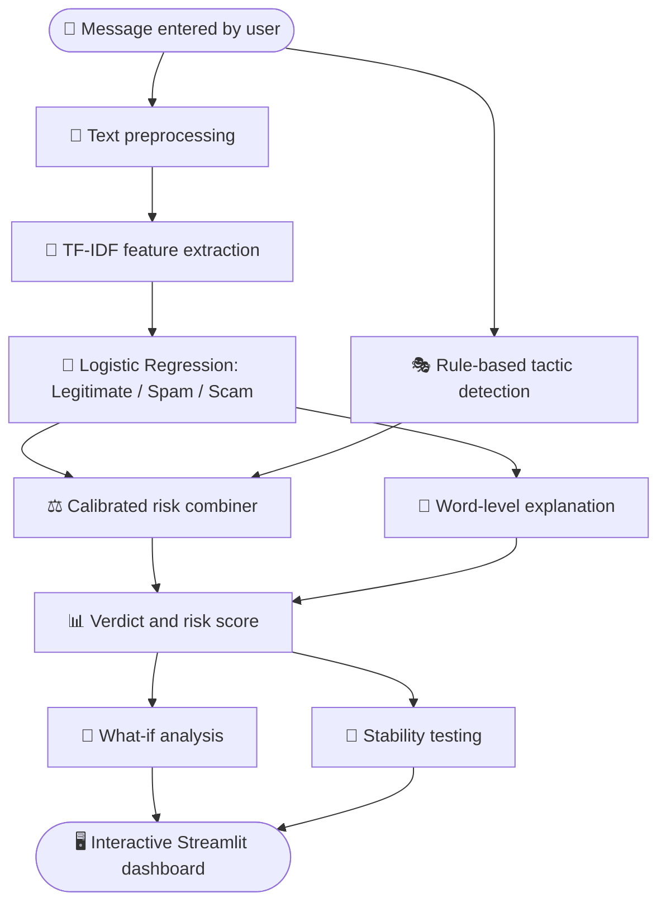

<div align="center">


# ScamLens

### *Explain the Scam, Not Just the Spam.*

An **Explainable AI (XAI)** system that shows people *why* a message looks suspicious, not just *whether* it does.

<br/>


### 🚀 [Live Demo](LIVE_DEMO_LINK)

[Overview](#-overview) • [Features](#-key-features) • [Tech Stack](#-technology-stack) • [How It Works](#-methodology) • [Results](#-results) • [Setup](#-installation-and-usage) • [Limitations](#-limitations) • [Roadmap](#-future-scope)

</div>

---

## 📖 Overview

**ScamLens** analyzes SMS messages, sorts them into **Legitimate**, **Spam** (unwanted promotion) or **Scam** (smishing), identifies suspicious language, explains common psychological manipulation tactics, and lets users explore how changes to a message affect the result.

Built by **Team VectorX** for **AI Innovation Hackathon 2026, Challenge 05**.

> ⚠️ **Note:** ScamLens is an awareness and decision-support tool. Its output is **not** definitive proof that a message is fraudulent or safe.

## 👥 Team VectorX

| Name | Role |
|---|---|
| **M.A.N.P. Anawarathne** |  Team Leader |
| **H.M.H.N. Aberathna** | Team Member |
| **W.A.H. Sathsarani** | Team Member |

---

## 🎯 Problem Statement

People regularly receive suspicious messages that imitate trusted organizations, create urgency, threaten negative consequences, or promise rewards. A simple spam/scam label rarely explains what makes a message suspicious, leaving users without enough context to judge the risk or to recognize manipulation in future messages.

### The Transparency Gap

Many message classifiers give a prediction with no clear explanation. ScamLens closes this gap by combining text classification with interpretable word-level evidence and rule-based explanations of possible manipulation tactics. It also shows that predictions can change when wording is altered, helping users understand both the value and the limitations of AI-based detection.

## 💡 Proposed Solution

ScamLens combines a machine-learning classifier with explanation tools in one interactive dashboard. Alongside a calibrated scam risk score, it:

- Separates real scams from ordinary promotional spam
- Highlights the most influential words
- Identifies possible manipulation tactics
- Provides safety guidance
- Lets users edit a message and test how robust the prediction is

---

## 🚀 Key Features

| Feature | Description |
|---|---|
| **Three-class classification** | Predicts whether a message is Legitimate, Spam (promotional) or Scam (smishing). |
| **Calibrated scam risk score** | A learned model combines the classifier's scores with the detected tactics into one risk score, calibrated on held-out data. |
| **Word-level explainability** | Highlights the words that push a message towards or away from Scam. |
| **Manipulation-tactic detection** | Flags patterns linked to *urgency*, *fear or threats*, *authority*, *rewards or greed*, and *calls to action*, using transparent rules. |
| **What-if analysis** | Edit the message text and compare how the risk score and detected tactics change. |
| **Prediction-stability testing** | Checks how typos, leetspeak or obfuscated wording can affect the result. |
| **Message history** | Reopen any message analyzed during the session. |
| **Model insights** | Shows per-class metrics, a confusion matrix, calibration results, tactic validation and influential words. |

---

## 🧰 Technology Stack

| Component | Technology |
|---|---|
| Programming language | Python |
| Text representation & classification | TF-IDF and multinomial Logistic Regression |
| Risk score | Stacked Logistic Regression trained on out-of-fold predictions |
| Explainability | Linear feature contributions and optional LIME |
| Manipulation-tactic analysis | Rule-based pattern matching |
| Interactive dashboard | Streamlit |
| Charts & visual analysis | Plotly |
| Testing | pytest |

---

## 🔬 Methodology
1. **Text preprocessing:** normalize message text and replace links, phone numbers, emails, money amounts and numbers with placeholder tokens.
2. **Feature extraction:** represent text using TF-IDF features, including single words and two-word phrases.
3. **Model training:** train a class-balanced multinomial Logistic Regression to separate Legitimate, Spam and Scam messages.
4. **Tactic analysis:** use rule-based patterns to identify possible psychological manipulation tactics.
5. **Risk scoring:** a second Logistic Regression combines the classifier's scam and spam scores with the five tactic flags. It is trained on 5-fold out-of-fold predictions, so the test set is never used, and its weights are learned rather than chosen by hand.
6. **Local explanation:** calculate the contribution of each word or phrase to the Scam prediction, and optionally generate a LIME explanation.
7. **What-if & stability analysis:** compare risk scores for edited messages and generated text variations.
8. **Interactive presentation:** display results, explanations, model insights and safety guidance in a Streamlit dashboard.

## 🏗️ Architecture / Workflow



---

## 🗂️ Dataset Information

ScamLens is trained on the **SMS Phishing Dataset for Machine Learning and Pattern Recognition** (Mishra and Soni, Mendeley Data, 2022). It contains 5,971 English SMS messages labelled **ham**, **spam** and **smishing**, which we map to Legitimate, Spam and Scam. Keeping spam and scam separate matters: promotional spam is unwanted, while smishing tries to steal money or personal data.

| Step | Detail |
|---|---|
| Ambiguous messages removed | 34 texts that appear with two different labels |
| Duplicates removed | Leaves **5,797** unique messages |
| Final classes | 4,834 Legitimate · 435 Spam · 528 Scam |
| Split | Stratified 80/20 with a fixed seed: 4,637 train, 1,160 test |

The data is English only and was collected online, partly from older spam collections, so test results should **not** be read as a guarantee of performance on real-world or local scams.

## 🧠 Models Used

| Model / Component | Purpose |
|---|---|
| **TF-IDF vectorizer** | Converts message text into numerical features using unigrams and bigrams. |
| **Multinomial Logistic Regression** | Predicts the probability of Legitimate, Spam and Scam. |
| **Risk combiner (Logistic Regression)** | Learns how much the classifier scores and each tactic flag should count, and outputs the calibrated scam risk score. |
| **Linear feature contributions** | Explain which words or phrases influence the Scam prediction. |
| **LIME** *(optional)* | Adds a model-agnostic local explanation. |
| **Rule-based tactic detector** | Identifies patterns tied to common manipulation strategies. This is an explanation layer, **not** a separately trained ML model. |

---

## 📊 Results

Evaluated on the held-out test set of **1,160 messages**:

| Class | Precision | Recall | F1 score |
|---|:-:|:-:|:-:|
| Legitimate | 0.989 | 1.000 | 0.994 |
| Spam | 0.922 | 0.816 | 0.866 |
| Scam | **0.943** | **0.934** | **0.938** |

Overall accuracy **0.980**, macro F1 **0.933**. No legitimate message was flagged as spam or scam.

### Scam risk score

| Method | ROC AUC (higher better) | Brier score (lower better) | Calibration error (lower better) |
|---|:-:|:-:|:-:|
| Classifier only | 0.9951 | 0.0100 | 0.0094 |
| Hand-made formula (earlier version) | 0.9974 | 0.0118 | 0.0249 |
| **Learned, calibrated risk score (used)** | **0.9976** | **0.0095** | **0.0064** |

### Tactic rule validation

How often each rule fires in each class, across the whole dataset:

| Tactic | Legitimate | Spam | Scam |
|---|:-:|:-:|:-:|
| Urgency | 1.3% | 13.3% | 34.1% |
| Fear / Threat | 1.3% | 0.2% | 2.5% |
| Authority Impersonation | 0.6% | 2.3% | 4.0% |
| Reward / Greed | 1.8% | 31.0% | 47.0% |
| Suspicious Call to Action | 0.2% | 44.6% | 67.4% |
| **Any tactic** | **4.9%** | **67.4%** | **86.4%** |

> 📝 These results apply to this dataset's test split. They may not reflect performance on emails, targeted fraud, multilingual messages, or newly emerging scam techniques.

---

## 🖼️ Screenshots / Demo

🚀 **Try it live:** [LIVE_DEMO_LINK](LIVE_DEMO_LINK)

The dashboard has a sidebar with eight pages:

| Page | What you can do |
|---|---|
| **Home** | Paste a message or try an example, then click Analyze. |
| **Analyze Message** | See the verdict, risk score, why it is suspicious, highlighted words and safety advice. |
| **What-If Lab** | Edit a message and compare the risk before and after. |
| **Stability Check** | See whether typos or obfuscated wording can fool the model. |
| **History** | Reopen earlier analyses from the session. |
| **Tips & Awareness** | Learn common scam types and the five manipulation tactics. |
| **Model Insights** | Review metrics, calibration, tactic validation and limitations. |
| **Settings** | Turn LIME and technical details on or off. |

<!-- Add dashboard screenshots here, e.g.  -->

## ⚙️ Installation and Usage

Quick start (Python 3.11 or newer):

```bash
cd code
python -m venv .venv
# Windows: .venv\Scripts\activate    Mac/Linux: source .venv/bin/activate
pip install -r requirements.txt
streamlit run app.py
```

The model trains automatically on first start (about 30 seconds). Full setup, training and test commands are in the detailed guide.

👉 **[Open the detailed setup and usage guide](code/README.md)**

---

## ⚠️ Limitations

- **Dataset:** English SMS only, collected online and partly built from older spam collections. Sinhala, Tamil and Singlish scams are not covered, so real-world accuracy will be lower than the test scores.
- **Tactics are rules, not a trained model:** no public dataset labels manipulation tactics, so the rules are transparent and auditable but can miss creative wording or flag harmless messages that mention a bank or a prize. Fear/Threat and Authority fire rarely in this dataset, so they have the weakest evidence.
- **The risk score is not a probability of fraud:** it is calibrated on this dataset's test split. On messages unlike the training data, the number may be off, so treat it as a risk indicator.
- **Robustness:** leetspeak, missing letters and dotted words can change the result, as the Stability Check shows.
- **Text only:** ScamLens does not verify URLs, sender identity or whether an organization is real. A low score does not guarantee safety.

## 🔭 Future Scope

- [ ] Add support for **Sinhala, Tamil, and Singlish** messages, with evaluation across languages
- [ ] Normalize leetspeak and spacing tricks to improve robustness
- [ ] Hand-label a set of tactic examples to measure rule precision and recall, or train a tactic classifier
- [ ] Expand the dataset with verified local scam, phishing and legitimate examples
- [ ] Explore multilingual transformer models (for example XLM-R) and compare performance and explainability
- [ ] Add URL and sender-reputation analysis where reliable data sources exist
- [ ] Improve accessibility and provide clearer, user-tested safety recommendations

---

## 📚 External Resources / Attributions

| Resource | Link |
|---|---|
| SMS Phishing Dataset (Mishra and Soni, 2022) | [Mendeley Data, doi:10.17632/f45bkkt8pr.1](https://data.mendeley.com/datasets/f45bkkt8pr/1) |
| LIME | [Local Interpretable Model-agnostic Explanations](https://github.com/marcotcr/lime) |
| Streamlit | [Official documentation](https://docs.streamlit.io/) |
| scikit-learn | [Official documentation](https://scikit-learn.org/stable/) |

Please review and preserve the relevant licenses and attribution requirements for all third-party datasets and libraries used in this project.

---

<div align="center">

### 🔍 ScamLens: *Explain the Scam, Not Just the Spam.*

Made with 💙 by **Team VectorX** · AI Innovation Hackathon 2026

</div>
