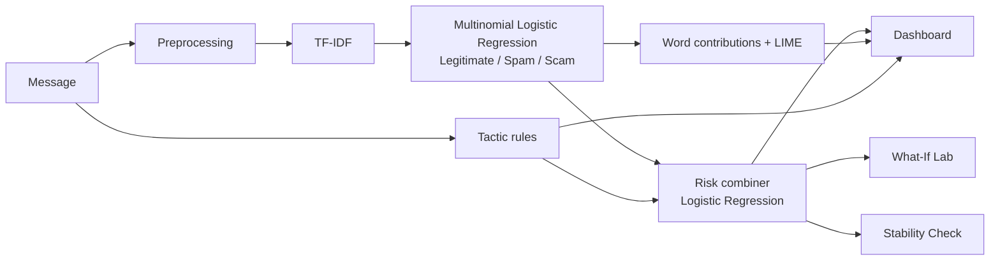

# ScamLens Technical Documentation

## 1. Architecture



ScamLens has two learned layers and one rule layer:

1. **Text model:** TF-IDF features feeding a multinomial Logistic Regression that outputs P(Legitimate), P(Spam) and P(Scam).
2. **Tactic rules:** regular expressions for five manipulation tactics, producing five yes/no flags and the matched phrases.
3. **Risk combiner:** a Logistic Regression that takes the text model's scam and spam scores plus the five flags, and outputs the calibrated scam risk score shown to the user.

## 2. Code structure

```
code/
  app.py                    Streamlit dashboard (8 pages, sidebar navigation)
  requirements.txt          pinned dependency versions
  .streamlit/config.toml    theme
  data/sms_phishing.csv     dataset
  src/
    preprocess.py           text cleaning and placeholder tokens
    tactics.py              tactic rules, explanations and safety tips
    model.py                ScamLensModel: text model + combiner, analyze()
    train.py                training, evaluation, calibration, tactic validation
    explain.py              word contributions, LIME, highlighting
    stability.py            perturbations and stability score
  tests/test_scamlens.py    12 automated tests
  models/                   created by training (not committed)
```

| Module | Key functions |
|---|---|
| `preprocess.py` | `clean_text(text)`, `pretty_token(token)` |
| `tactics.py` | `detect_tactics(text)`, `TACTICS`, `SAFETY_TIPS` |
| `model.py` | `ScamLensModel.analyze(text)`, `.predict_proba(texts)`, `.scam_risk(texts)`, `combiner_features(...)`, `tactic_flags(texts)` |
| `train.py` | `load_data()`, `build_text_model()`, `main()` |
| `explain.py` | `coefficient_explanation(model, text)`, `lime_explanation(model, text)`, `highlight_html(text, weights)` |
| `stability.py` | `generate_variants(text)`, `check_stability(model, text)` |

## 3. Preprocessing

Text is lowercased, then these patterns are replaced with placeholder tokens so the model learns the pattern rather than specific values:

| Pattern | Token | Shown to users as |
|---|---|---|
| URLs and domains | `urltoken` | [a link] |
| Email addresses | `emailtoken` | [an email address] |
| Money amounts (£, $, €, Rs, LKR) | `moneytoken` | [a money amount] |
| Phone numbers (8 or more digits) | `phonetoken` | [a phone number] |
| Other numbers | `numtoken` | [a number] |

## 4. Text model

* `TfidfVectorizer(ngram_range=(1, 2), min_df=2, sublinear_tf=True)` with `clean_text` as the preprocessor.
* `LogisticRegression(C=10, class_weight="balanced", max_iter=3000)`, multinomial over the three classes. Class balancing compensates for Legitimate being 83% of the data.

## 5. Risk combiner

Features for each message:

```
[ logit(P(Scam)), logit(P(Spam)), Urgency, Fear/Threat, Authority, Reward/Greed, Call to Action ]
```

where `logit(p) = ln(p / (1 - p))` and the five tactic values are 0 or 1.

Training avoids leakage:
1. Split the data 80/20 (stratified, seed 42).
2. On the training set only, run 5-fold `cross_val_predict` so every training message gets text-model probabilities from a model that did not see it.
3. Fit `LogisticRegression(C=1.0)` on those out-of-fold features with target `y == Scam`.
4. Fit the final text model on the full training set.
5. Evaluate both layers on the untouched test set.

Learned weights (positive means the signal raises the risk):

| Input | Weight |
|---|---|
| AI model: scam score | 1.269 |
| AI model: spam score | 0.560 |
| Tactic: Authority Impersonation | 0.801 |
| Tactic: Fear / Threat | 0.543 |
| Tactic: Suspicious Call to Action | 0.408 |
| Tactic: Urgency | 0.291 |
| Tactic: Reward / Greed | 0.254 |

## 6. Explainability

**Word contributions (always on).** For the Scam class of a multinomial model:

```
contribution(word) = tfidf(word) x ( w_scam(word) - mean(w_legitimate(word), w_spam(word)) )
```

This is exact for the linear text model, so it costs no extra computation.

**LIME (optional).** `LimeTextExplainer` removes random words 800 times, fits a local linear surrogate, and reports each word's weight for the Scam class. It is model-agnostic, so it would still work with a different classifier.

**Global explanation.** The same scam direction vector over the whole vocabulary gives the top scam and non-scam indicators shown in Model Insights.

## 7. Tactic rules

Each tactic has several case-insensitive regular expressions in `src/tactics.py`. `detect_tactics` returns, for each tactic that matched, its name, an explanation and the exact phrases found. Rules are validated by their firing rate per class (see the [Model Card](model-card.md)).

## 8. Stability Check

Seven perturbation types generate up to `n` variants each: leetspeak, swapped letters, missing letter, dotted word, casing change, extra punctuation and synonym swap. Each variant is re-scored with the final risk score.

```
flip_rate  = share of variants that land on the other side of 0.5
mean_shift = average |risk(variant) - risk(original)|
score      = 100 x (1 - 0.7 x flip_rate - 0.3 x min(1, mean_shift / 0.5))
```

Verdict: Stable (80 or more), Somewhat fragile (55 to 80), Fragile (under 55).

## 9. Dashboard

`app.py` uses Streamlit session state for navigation (`page`), the message draft, the current result, history and settings. Results come from `ScamLensModel.analyze`, which returns the class probabilities, predicted label and risk score. If no saved model exists, the app trains one on first start (about 30 seconds) and caches it with `st.cache_resource`.

## 10. Testing

`python -m pytest -q` runs 12 tests:

* an obvious scam is flagged; a normal message is Legitimate; a shop promotion is Spam, not Scam
* class probabilities sum to 1
* all five slide examples trigger the expected tactic
* the calibrated score is at least as good as the old formula on Brier score and calibration error
* tactics fire more on scams than on legitimate messages
* explanations and the stability check run

## 11. Deployment

Deployed on Streamlit Community Cloud from this repository: branch `main`, main file `code/app.py`, Python 3.12 or 3.13. Dependencies are pinned in `code/requirements.txt`. The `models/` folder is not committed; the server trains the model on first start. Each push to `main` updates the live app.
